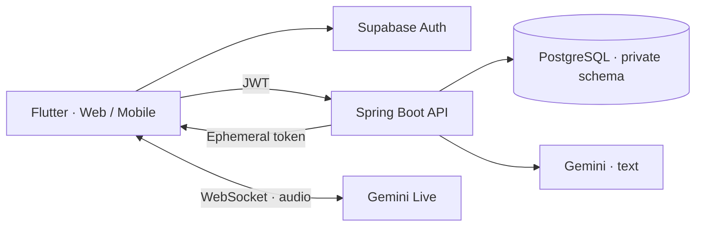

<p align="center">
  
</p>

<p align="center">
  
  
  
  
  
</p>

<p align="center">
  <strong>Không gian luyện tiếng Anh cùng Tom.</strong><br />
  Hội thoại tự nhiên, giọng nói trực tiếp và lộ trình từ dữ liệu học của chính bạn.
</p>

<p align="center">
  <a href="#tính-năng">Tính năng</a> ·
  <a href="#bắt-đầu">Bắt đầu</a> ·
  <a href="#kiểm-thử">Kiểm thử</a> ·
  <a href="#bảo-mật-và-dữ-liệu">Bảo mật</a> ·
  <a href="#tài-liệu">Tài liệu</a>
</p>

---

## Giới thiệu

**FluentTalk** là ứng dụng Flutter với trợ lý ảo **Tom**, dùng Spring Boot làm backend và Supabase cho xác thực, PostgreSQL. Giao diện thích ứng với điện thoại và trình duyệt desktop; dữ liệu học được tách theo tài khoản đăng nhập.

Dự án đang ở giai đoạn **beta chạy local**. Hội thoại thật và cá nhân hóa đã được tích hợp; việc triển khai production, nghiệm thu thiết bị và phát hành cửa hàng còn nằm trong lộ trình.

## Tính năng

| Khu vực | Khả năng hiện tại |
| --- | --- |
| **Tài khoản** | Đăng ký, đăng nhập, xác thực OTP email qua Supabase; hồ sơ và mục tiêu học. |
| **Chat cùng Tom** | Phản hồi Gemini thật, lưu phiên hội thoại, mở lại lịch sử và phát giọng đọc. |
| **Hội thoại giọng nói** | Gemini Live trên web, Android và iOS: micro, âm thanh trực tiếp, phụ đề, ngắt lời và chọn giọng. |
| **Cá nhân hóa** | Mục tiêu, trình độ tự chọn, chủ đề ưu tiên; kế hoạch ngày và tình huống kèm lý do đề xuất. |
| **Ghi nhớ có kiểm soát** | Dùng lịch sử khi bật cá nhân hóa; lưu phụ đề cuộc gọi khi đồng ý riêng, tối đa 30 ngày, có thể xóa. |
| **Nội dung học** | Danh mục chủ đề, tình huống theo trình độ, lịch sử và thống kê từ dữ liệu đã lưu. |
| **Quản trị** | Giao diện web/mobile, quản lý học viên, chủ đề, tình huống, nhật ký thao tác và thống kê thật; API giới hạn quyền admin. |

Tom không tạo điểm năng lực, nhận xét phát âm hoặc lịch sử giả. Khi chưa có dữ liệu, đề xuất bắt đầu từ lựa chọn của người học. Phút luyện tập hiện tính theo phiên chat đã hoàn thành; phụ đề Live chưa cộng vào chỉ số thời gian này.

## Kiến trúc



API key Gemini và mật khẩu database chỉ được nạp ở backend. Ứng dụng nhận token Live ngắn hạn, không nhận API key lâu dài.

## Bắt đầu

### Yêu cầu

| Công cụ | Mục đích |
| --- | --- |
| Flutter SDK | Cài dependencies, chạy và build ứng dụng. |
| Python 3 | Script cấu hình và khởi chạy local. |
| **JDK 27** | Build/chạy backend; đặt `JAVA_HOME` trên máy của bạn. |
| **JDK 21** | Toolchain Android đã được kiểm chứng, độc lập với JDK backend. |
| Supabase project | Email Auth và PostgreSQL có quyền chạy migration. |
| Gemini API key | Chat và Live; project cần có model/quota phù hợp. |

Backend hiện dùng **Spring Boot 4.2.0-M2**. Đây là bản milestone; cần đánh giá phiên bản ổn định trước khi triển khai production.

### 1. Cài dependencies và tạo cấu hình

Chạy các lệnh từ thư mục gốc repository:

```bash
flutter pub get
cp -n config/mobile.public.example.json config/mobile.public.json
cp -n config/backend.private.env.example config/backend.private.env
chmod 600 config/backend.private.env
```

Lệnh `cp -n` giữ nguyên file cấu hình đã tồn tại. Điền thông tin trực tiếp trên máy:

| File | Cấu hình |
| --- | --- |
| `config/mobile.public.json` | `SUPABASE_URL`, publishable key trong `SUPABASE_ANON_KEY`, `API_BASE_URL`. |
| `config/backend.private.env` | PostgreSQL URL/user/password, Supabase issuer/JWKS, `GEMINI_API_KEY`, model text/Live và CORS. |

`backend.private.env` được đọc như dữ liệu, không chạy bằng `source` hay `eval`. Không truyền file này vào `--dart-define-from-file`.

Flyway tự chạy các migration **V1–V12** trong schema `english_app`. Các migration tạo bảng/cập nhật dữ liệu; hãy dùng database phát triển phù hợp, không bỏ qua migration để tự tạo bảng bằng tay.

### 2. Chạy backend và web

```bash
./start_app.sh
```

Trình chạy sẽ verify backend, build web, nạp cấu hình local và kiểm tra health trước khi phục vụ:

- **Web:** <http://localhost:3000>
- **Backend health:** <http://localhost:8080/api/v1/health>

`Ctrl+C` dừng hai dịch vụ do script tạo. Nếu cổng 3000/8080 đang có tiến trình khác, dừng tiến trình đó trước khi chạy lại. Log được ghi vào `.run/` và không đưa lên Git.

Cấu hình web public được sinh riêng thành `config/mobile.web.public.json`. Để kiểm tra cấu hình/database mà không in secret:

```bash
python3 scripts/run_backend.py --check-config
python3 scripts/check_supabase.py
```

### 3. Thiết lập email và cá nhân hóa

- **Email OTP:** bật Confirm email, cấu hình Custom SMTP và mẫu email có `{{ .Token }}`. Xem [hướng dẫn email OTP](docs/THIET_LAP_EMAIL_OTP.md).
- **Tom:** đăng nhập → tab **Tom** → bật cá nhân hóa, chọn mục tiêu/chủ đề/giọng → lưu. Ghi nhớ phụ đề cần bật riêng. Xem [cá nhân hóa Tom](docs/CA_NHAN_HOA_TOM.md).
- **Gọi thoại:** vào **Luyện tập**, bắt đầu cuộc gọi và cấp quyền micro. Dùng localhost hoặc HTTPS; nên dùng tai nghe. Xem [thiết lập realtime](docs/THIET_LAP_AI_REALTIME.md).

### Android, iOS và chế độ demo

```bash
flutter run --dart-define-from-file=config/mobile.public.json
flutter build apk --debug --dart-define-from-file=config/mobile.public.json
# macOS with Xcode: launch the iOS simulator or a signed iPhone build
flutter run -d ios --dart-define-from-file=config/mobile.public.json
```

Với Android emulator, đặt API thành `http://10.0.2.2:8080/api/v1` và `ALLOW_INSECURE_LOCALHOST=true`. Thiết bị thật cần backend có thể truy cập; bản phát hành dùng HTTPS. Cuộc gọi Live có transport native Android/iOS và cấu hình audio chuyên cho thoại. APK debug không phải bản ký phát hành; chạy trên iPhone thật cần Xcode và cấu hình ký ứng dụng. Chất lượng loa, micro, tai nghe Bluetooth và định tuyến trên từng mẫu máy vẫn cần nghiệm thu thực tế.

Chạy dữ liệu minh họa độc lập:

```bash
flutter run --dart-define=DEMO_MODE=true
```

## Kiểm thử

```bash
flutter analyze
flutter test
(cd backend && ./mvnw verify)
python3 scripts/check_git_secrets.py --history
```

Một số kiểm thử được bật riêng:

```bash
# Kiểm tra concurrency trên PostgreSQL thật trong schema QA tạm, rồi xóa schema đó.
python3 scripts/check_supabase.py --concurrency

# Kiểm tra transport audio bằng WebAudio/WebSocket giả lập; cần Node.js.
node --test test/live_audio_transport_test.cjs

# Render giao diện qua app root thật, dùng dữ liệu fixture.
flutter test --dart-define=CAPTURE_UI=true test/academic_design_test.dart
```

Kiểm thử provider thật cần chủ động bật `LIVE_PROVIDER_SMOKE=true` cùng biến môi trường Gemini của backend; có thể phát sinh sử dụng API. Bộ verify thông thường không gọi provider thật hoặc database production. Ảnh render và fixture không thay thế nghiệm thu micro/loa, email và thiết bị thật.

Workflow [Backend CI](.github/workflows/backend-ci.yml) hiện build/test backend trên push/PR tới `main` hoặc `develop` khi các đường dẫn liên quan thay đổi; đây chưa phải pipeline triển khai production.

## Bảo mật và dữ liệu

- Chỉ commit **file mẫu**. `.gitignore` loại cấu hình local, file môi trường, khóa ký, credentials, runtime log và database dump.
- Supabase JWT xác định chủ sở hữu dữ liệu ở backend. Schema học tập không cấp quyền Data API trực tiếp cho `anon`/`authenticated`.
- Cá nhân hóa và lưu phụ đề mặc định tắt. Phụ đề chỉ lưu khi đồng ý; không lưu audio. Có tùy chọn xóa và tác vụ dọn phụ đề quá hạn.
- Script `check_git_secrets.py` rà các định dạng credential thường gặp, giá trị private local đang dùng, nội dung staged và lịch sử khi có `--history`. Script chỉ báo đường dẫn/loại, không in key. Đây là kiểm tra hỗ trợ, không bảo đảm phát hiện mọi loại secret.
- `.gitignore` không gỡ dữ liệu đã commit. Nếu phát hiện credential trong lịch sử, thu hồi/đổi credential và xử lý lịch sử trước khi public repository.

## Cấu trúc repository

```text
lib/                    Flutter UI, domain, repository và API adapters
backend/                Spring Boot API, security, learning và Flyway migrations
web/                    Web bootstrap, audio transport và AudioWorklet
config/                 File mẫu được commit; cấu hình thật chỉ nằm local
supabase/               Cấu hình dự án và mẫu email
scripts/                Khởi chạy, kiểm tra database và rà secret
test/                  Flutter tests và audio transport tests
docs/                  Kế hoạch, hướng dẫn và báo cáo kiểm tra
```

## Tài liệu

| Nội dung | Đường dẫn |
| --- | --- |
| Cấu hình và xác thực email | [Thiết lập OTP](docs/THIET_LAP_EMAIL_OTP.md) |
| Hội thoại trực tiếp | [Gemini Live](docs/THIET_LAP_AI_REALTIME.md) |
| Cá nhân hóa, dữ liệu và consent | [Tom personalization](docs/CA_NHAN_HOA_TOM.md) |
| Kết quả tích hợp gần nhất | [Tom & personalization QA](docs/qa/TOM_PERSONALIZATION_2026_10_23.md) |
| Kế hoạch tổng thể | [Tám giai đoạn](docs/KE_HOACH_8_GIAI_DOAN.md) |
| Công việc giai đoạn 4–8 | [Kế hoạch chi tiết](docs/KE_HOACH_CHI_TIET_GIAI_DOAN_4_DEN_8.md) |

## Lộ trình

Các hạng mục còn lại gồm nghiệm thu cuộc gọi trên thiết bị Android/iOS và mạng yếu, guided speaking, đánh giá kỹ năng có bằng chứng/hiệu chuẩn, ôn từ vựng và bài tập chuyên sâu, full password-recovery/account lifecycle, cùng hosting HTTPS, quyền database tối thiểu, backup/restore, monitoring và release signing.

Có schema, màn hình demo hoặc hợp đồng API không đồng nghĩa tính năng đã hoàn thiện. Trạng thái thực tế được ghi trong hướng dẫn và báo cáo QA tương ứng.

Hướng dẫn vận hành và cấp quyền: [Quản trị FluentTalk](docs/ADMIN_CONSOLE.md).

Đo token thực tế và biểu đồ ngày: [Usage Analytics](docs/USAGE_ANALYTICS.md).
