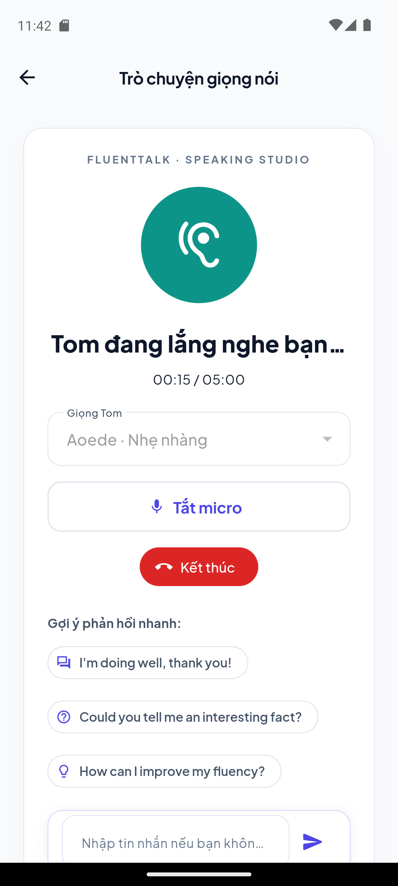

# Android Gemini Live QA — 29/10/2026

Project: `D:\mobile English\fluentTalk-mobile-app`. Tested on the running Android emulator named **Pixel_7** (`emulator-5554`, x86_64). The installed app uses the real backend, Supabase authentication and Gemini provider; demo mode is off.

## Faults and changes

- The old native client waited for `setupComplete == true`. Gemini sends an empty protobuf message (`setupComplete: {}`), so the app never entered the connected state and eventually timed out.
- The old native client had no microphone capture or PCM playback. It sent typed text and read response transcripts with TTS. Android now uses AudioRecord at 16 kHz mono PCM16 and plays the provider's 24 kHz PCM through AudioTrack.
- The native transport now uses `wss`, processes server frames sequentially, handles input/output transcription and interruption, and settles pending connection futures on timeout, cancellation, denial and socket closure. A late socket cannot revive a cancelled call.
- The timed run exposed Gemini closing with code 1011 near credential expiry. The client now recognizes a normal/1011 close in the final 10 seconds of a connected ticket as expiry, while an early 1011 remains a connection error. Two regression tests verify the distinction; raw close reasons and credentials are not logged.
- Android asks for microphone permission before requesting a billable Live ticket. Capture begins after the provider acknowledges setup. Per-call IDs reject stale callbacks from a previous call.
- Audio recording and playback run off the UI thread. Microphone frames are 40 ms. Playback is bounded (at most 384,000 queued PCM bytes); queued audio is flushed when interrupted. Echo cancellation/noise suppression are enabled when supported. Audio focus, routing, recorder and player are released when a call ends or the activity stops.
- Mute controls the microphone uplink; Tom's audio remains audible. The button labels/icons now describe this correctly.
- Daily voice allowance is configurable via `DAILY_VOICE_MINUTES`. The user approved **60 minutes/day on this local backend**. Other environments retain the 15-minute default. Each issued ticket still reserves 5 minutes; early hang-up does not refund a reservation.
- The emulator host microphone input was enabled for real speech testing. No provider API key was placed in the app.

## Automated checks

| Check | Result |
| --- | --- |
| Full Flutter suite on final source | **205 passed** |
| Native transport + Live screen tests (included above) | **14 passed** |
| Static analysis of native transport, platform adapter, Live screen and new tests | **No issues found** |
| Backend test reports | **92 discovered, 87 passed, 5 opt-in skipped; 0 failures/errors** |
| Backend packaging | Passed after stopping the running JAR to release its Windows file lock |
| Android debug APK | Built and installed successfully, preserving application data |
| Secret scan | No matching credentials in 458 push-eligible files/staged changes |

Transport regression tests cover the real `setupComplete: {}` envelope, the secure WebSocket URI/token query, microphone PCM encoding, output PCM ordering, both transcripts, interruption, playback completion, mute/unmute, permission failure, invalid PCM, object-valued goAway, cancellation during handshake/DNS/TLS, timeout and provider disconnect.

## Pixel 7 acceptance

- Denied microphone permission: actionable error; app remained usable and allowed retry.
- Granted microphone permission: Live connected to Gemini and Android opened the 16 kHz input and 24 kHz output paths.
- Real microphone conversation: both user and Tom transcripts were observed. The user explicitly confirmed hearing Tom reply through the speaker.
- Repeated starts after ending earlier calls: connected successfully.
- Microphone mute/unmute in one active call: UI and transport returned to listening without replacing the session.
- Backgrounding: the app stopped the call, displayed the background-stop message on return, and Android audio policy showed the app's input/output sessions released.
- Timed call: observed connected at 81, 161, 196 and 273 seconds, with no errors in the current app process. Gemini closed at 294 seconds near its five-minute ticket deadline. Android audio policy then showed the app's input/output sessions released; `_active=false`, `_connecting=false`. The initial generic disconnect message at this boundary was corrected as described above and verified by regression tests.
- Approximate debug app memory during the timed run: 300,837–301,168 KiB PSS, 300,934 KiB after ending. These samples are evidence of this run only, not a comprehensive leak/performance benchmark.
- Final APK after the expiry-message correction: installed successfully, connected again to Gemini (`_active=true`, `_error=null`), then ended normally at 20 seconds (`_active=false`, `_connecting=false`, `_error=null`). The app is left on the call screen ready to start; no test call remains active.
- Final daily reservation ledger: 11 issued tickets / 55 reserved minutes. With the approved local limit of 60, **one 5-minute ticket remains today**. The application quota rolls over by UTC day; this is separate from Google API billing/quota.

Final installed APK, live connection screenshot:

## Scope and limits

The evidence is for this Pixel 7 emulator and the configured local services. It does not establish physical-device/Bluetooth/iOS coverage or latency under all networks. No claim of a universal frame-rate/latency target is made. iOS native transport remains unsupported. The backend stays running locally so the app can be used after handoff.

Build command: `flutter build apk --debug --dart-define-from-file=config/mobile.android.json`.

APK: `build/app/outputs/flutter-apk/app-debug.apk`.

Protocol reference used while repairing the transport: [Google Live API capabilities](https://ai.google.dev/gemini-api/docs/live-api/capabilities) and [ephemeral tokens](https://ai.google.dev/gemini-api/docs/live-api/ephemeral-tokens).
